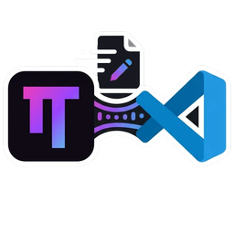

# OMP VS Code Bridge

[English](README.md) | [简体中文](README.zh-CN.md)

Agent edits land in your editor without stealing focus: tracked files open as diffs, untracked
ones open quietly, and every write can be approved, reverted, or left alone. The agent keeps
working in its terminal; VS Code becomes the review surface.

One package, two TypeScript halves: a VS Code extension (`src/client/`) and an OMP plugin
(`src/omp/`) that speak a loopback protocol (`src/protocol.ts`).

## Quick start

```bash
bun install
bun run package                                    # → omp-vscode-bridge-<version>.vsix
code --install-extension omp-vscode-bridge-*.vsix  # editor half
omp plugin link .                                  # agent half
```

Reload the window, start a new omp session, and check the status bar:

```bash
ls ~/.omp-vscode/servers/     # one record per running omp process
```

`OMP Bridge: 1/1` means connected. Ask the agent to touch a file — the diff appears, focus stays
in your terminal.

Requires VS Code 1.146+ and an `omp` build with plugin support.

## What you get

| Feature | Trigger | Behavior |
|---|---|---|
| Edit surfacing | automatic | Tracked files open as a HEAD diff, untracked as a silent open. Disable opening with `ompBridge.autoOpen`. |
| Approval gate | automatic | Every `edit`/`write` asks Allow / Always Allow / Deny; `write` shows the proposed content first. Deny feeds an error back to the model; 60 s of silence allows. |
| Revert | **Recent edits** tree, or **Revert Edit** | Restores the pre-edit bytes, or deletes a file the agent created. Session-local, last 50 edits, 1 MB cap. |
| Per-turn context | automatic | Before each turn the window's active file, selection, and diagnostics are injected as `ide-context`; no tool call needed. Toggle with `ompBridge.shareContext`. |
| Context senders | `Ctrl+Alt+K` selection · `Ctrl+Alt+Shift+K` file · `Ctrl+Alt+Shift+P` problems · `Ctrl+Alt+G` diff · `Ctrl+Alt+Y` symbol | Plus **Send Open Tabs** and **Add Files**. `ompBridge.contextDelivery` picks `aside` (join the turn) or `queue` (next turn). |
| VS Code tools | `vscode_*` tools | `vscode_tools`/`vscode_tool` reach `vscode.lm.tools` (Copilot tools, VS Code-managed MCP servers), `vscode_diagnostics`, `vscode_command` (allowlist + confirm), `vscode_debug`, `vscode_task`. |
| Session binding | automatic, overridable | Terminals match by pid ancestry; **Pin Window to Session** binds explicitly when several terminals share a workspace. |

## Settings

| Setting | Default | Effect |
|---|---|---|
| `ompBridge.requireApproval` | `true` | Ask before writes; off means auto-allow. |
| `ompBridge.autoOpen` | `true` | Open/diff edits. Off only records them in the tree. |
| `ompBridge.showDiffs` | `true` | Preview proposed `write` content before approving. |
| `ompBridge.shareContext` | `true` | Inject the per-turn editor snapshot. |
| `ompBridge.includeDiagnostics` | `true` | Include diagnostics in that snapshot. |
| `ompBridge.contextDelivery` | `aside` | `aside` joins the running turn; `queue` waits for the next. |
| `ompBridge.diffScope` | `unstaged` | `unstaged`, `staged`, or `head` for **Send Git Diff**. |
| `ompBridge.ignoredPaths` | `**/node_modules/**`, `**/.git/**` | Globs never surfaced or recorded. |
| `ompBridge.allowedCommands` | `[]` | Command ids the agent may run. Empty means none. |
| `ompBridge.confirmCommands` | `true` | Modal confirm for each allowlisted command. |

## Commands

- **Sessions** — Show Sessions, Show Log File, Pin Window to Session, Unpin Session, Show Recent Edits
- **Edits** — Revert Edit, Forget Saved Approvals
- **Context** — Send Selection, Send File, Send Problems, Send Git Diff, Send Symbol at Cursor, Send Open Tabs, Add Files to Prompt

All live under the **OMP Bridge** category; the five keybindings above are the fast path.

## How it works

- The OMP plugin publishes one atomic endpoint record per process (pid ancestry, port, cwd,
  session id, per-process token) and serves it over `127.0.0.1`.
- Each window scans for records, matches them to its own terminals, registers with the token,
  and reconnects with backoff.
- Edits, approvals, context, and editor tooling all travel as newline-delimited JSON on that
  one socket; nothing leaves the machine and there is no telemetry.
- The protocol version is shared by both halves, so a mismatched pair shows 0 sessions instead
  of misbehaving.

## Documentation

[Architecture](docs/architecture.md) · [Protocol v4](docs/protocol.md) ·
[Development](docs/development.md) · [Security model](docs/security.md) ·
[Troubleshooting](docs/troubleshooting.md) · [Agent guide](AGENTS.md)

Governance: [security policy](SECURITY.md) · [code of conduct](CODE_OF_CONDUCT.md).

## Development

```bash
bun run typecheck   # tsc --noEmit over src/ (both halves)
bun run build       # tsc → dist/ (client + protocol)
bun run package     # build + vsce package
```

`.vscodeignore` ships only `dist/`, the manifest, the icon, and both READMEs.
