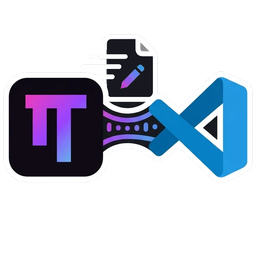

<p align="center">
  
</p>

<h1 align="center">OMP VS Code Bridge</h1>

[English](README.md) | 简体中文

<p align="center">
  <a href="https://open-vsx.org/extension/zandev32/omp-vscode-bridge"></a>
  
  <a href="https://github.com/ZanDev32/omp-vscode-bridge/actions/workflows/ci.yml"></a>
</p>

智能体的改动直接出现在编辑器里，不抢走焦点：已跟踪文件以 diff 打开，未跟踪文件静默打开，每次写入都可审批、可回滚、也可完全不打开。智能体仍在终端里工作，VS Code 成为审阅界面。

一个包、两个 TypeScript 半边：VS Code 扩展（`src/client/`）与 OMP 插件（`src/omp/`），通过回环协议（`src/protocol.ts`）通信。

## 安装

可从 [Open VSX](https://open-vsx.org/extension/zandev32/omp-vscode-bridge) 安装（`zandev32.omp-vscode-bridge`），或本地构建：

```bash
bun install
bun run package                                    # → omp-vscode-bridge-<version>.vsix
code --install-extension omp-vscode-bridge-*.vsix  # 编辑器半边
omp plugin link .                                  # 智能体半边
```

重载窗口，新开一个 omp 会话，然后检查状态栏：

```bash
ls ~/.omp-vscode/servers/     # 每个运行中的 omp 进程一条记录
```

`OMP Bridge: 1/1` 表示已连接。让智能体改一个文件——diff 会出现，焦点仍留在终端。

需要 VS Code 1.146+ 以及支持插件的 `omp` 版本。

## 功能

| 功能 | 触发方式 | 行为 |
|---|---|---|
| 改动展示 | 自动 | 已跟踪文件以 HEAD diff 打开，未跟踪文件静默打开。`ompBridge.autoOpen` 可关闭打开。 |
| 审批门 | 自动 | 每次 `edit`/`write` 提供 允许 / 始终允许 / 拒绝；`write` 会先展示拟写入内容。拒绝会把错误返回模型；60 秒无响应视为允许。 |
| 回滚 | **Recent edits** 树或 **Revert Edit** | 恢复编辑前字节，或删除智能体新建的文件。仅限本会话，保留最近 50 条，单文件上限 1 MB。 |
| 每轮上下文 | 自动 | 每轮开始前注入窗口的当前文件、选区与诊断（`ide-context`），无需模型调用工具。`ompBridge.shareContext` 可关闭。 |
| 上下文发送 | `Ctrl+Alt+K` 选区 · `Ctrl+Alt+Shift+K` 文件 · `Ctrl+Alt+Shift+P` 问题 · `Ctrl+Alt+G` diff · `Ctrl+Alt+Y` 符号 | 另有 **Send Open Tabs** 与 **Add Files**。`ompBridge.contextDelivery` 可选 `aside`（并入当前轮）或 `queue`（下一轮）。 |
| VS Code 工具 | `vscode_*` 工具 | `vscode_tools`/`vscode_tool` 调用 `vscode.lm.tools`（Copilot 工具、VS Code 管理的 MCP 服务），以及 `vscode_diagnostics`、`vscode_command`（白名单 + 确认）、`vscode_debug`、`vscode_task`。 |
| 会话绑定 | 自动，可覆盖 | 终端按进程祖先匹配；同一工作区多终端时用 **Pin Window to Session** 显式绑定。 |

## 设置

| 设置 | 默认值 | 作用 |
|---|---|---|
| `ompBridge.requireApproval` | `true` | 写入前询问；关闭即自动允许。 |
| `ompBridge.autoOpen` | `true` | 打开/diff 改动；关闭后仅在树中记录。 |
| `ompBridge.showDiffs` | `true` | 审批前预览 `write` 的拟写入内容。 |
| `ompBridge.shareContext` | `true` | 注入每轮编辑器快照。 |
| `ompBridge.includeDiagnostics` | `true` | 快照中包含诊断。 |
| `ompBridge.contextDelivery` | `aside` | `aside` 并入当前轮；`queue` 留到下一轮。 |
| `ompBridge.diffScope` | `unstaged` | **Send Git Diff** 的范围：`unstaged`、`staged`、`head`。 |
| `ompBridge.ignoredPaths` | `**/node_modules/**`, `**/.git/**` | 永不展示或记录的 glob。 |
| `ompBridge.allowedCommands` | `[]` | 允许智能体执行的命令 id，空表示不允许。 |
| `ompBridge.confirmCommands` | `true` | 每条白名单命令都弹窗确认。 |

## 命令

- **会话** —— Show Sessions、Show Log File、Pin Window to Session、Unpin Session、Show Recent Edits
- **编辑** —— Revert Edit、Forget Saved Approvals
- **上下文** —— Send Selection、Send File、Send Problems、Send Git Diff、Send Symbol at Cursor、Send Open Tabs、Add Files to Prompt

全部位于 **OMP Bridge** 分类下；上表五个快捷键是快速通道。

## 工作原理

- OMP 插件为每个进程原子写入一条端点记录（进程祖先链、端口、cwd、会话 id、每进程令牌），仅监听 `127.0.0.1`。
- 每个窗口扫描记录，按自身终端匹配，携带令牌注册，断线后指数退避重连。
- 改动、审批、上下文与编辑器工具能力共用同一套换行分隔 JSON 连接；数据不出本机，无遥测。
- 协议版本由两端共享，版本不匹配时显示 0 会话而不是行为异常。

## 文档

[架构](docs/architecture.md) · [协议 v4](docs/protocol.md) ·
[开发](docs/development.md) · [安全模型](docs/security.md) ·
[故障排查](docs/troubleshooting.md) · [智能体指南](AGENTS.md)

治理：[安全政策](SECURITY.md) · [行为准则](CODE_OF_CONDUCT.md)。

## 开发

```bash
bun run typecheck   # 对 src/（两端）执行 tsc --noEmit
bun run build       # tsc → dist/（客户端 + 协议）
bun run package     # build + vsce package
```

`.vscodeignore` 仅打包 `dist/`、清单、图标、许可证与两份 README。
